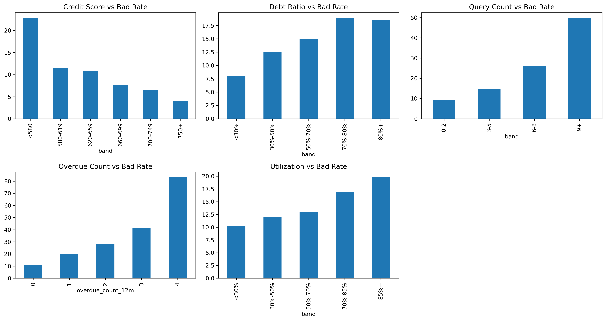
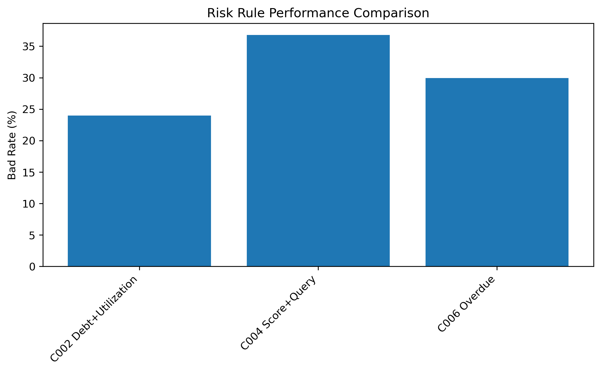
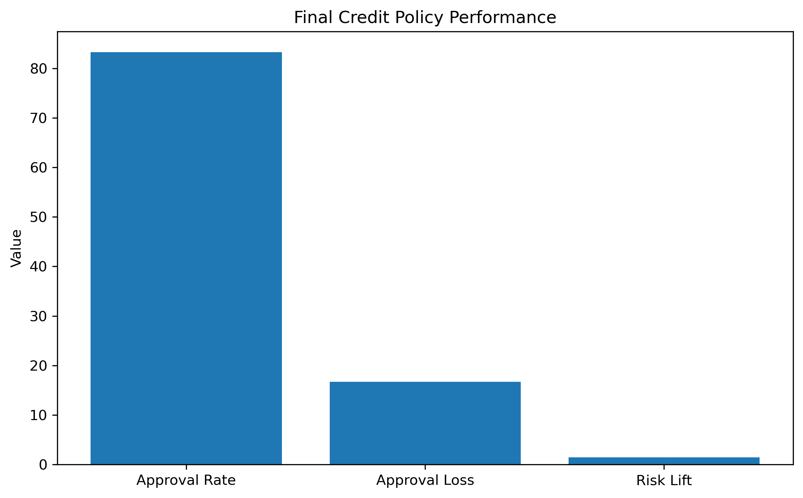
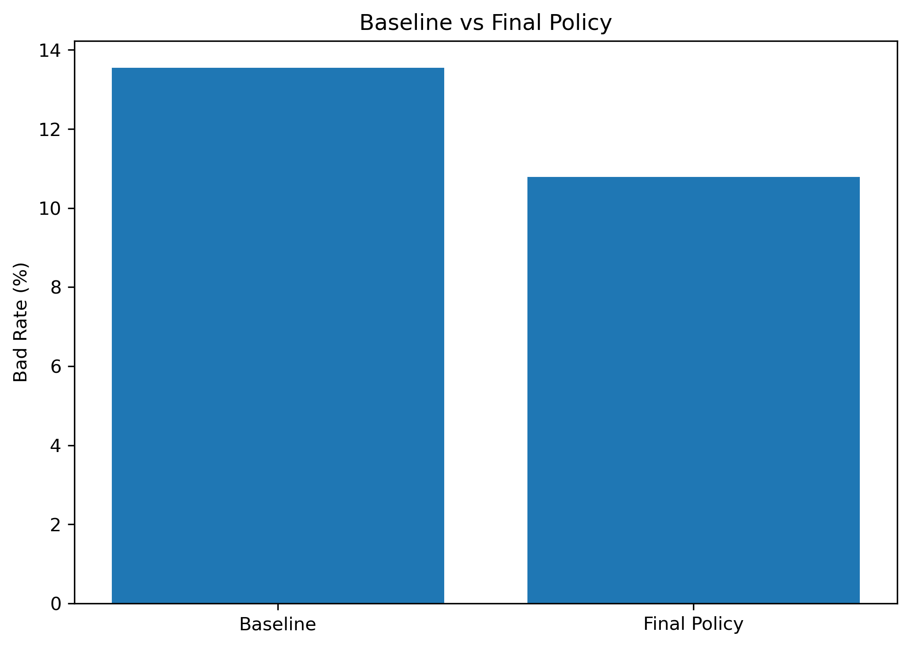

# Credit Risk Strategy Optimization Simulation

基于 Python 的信用风险策略优化模拟项目

## 1. Project Overview

本项目模拟银行信用审批场景，通过 Python 对信贷申请数据进行风险分析，并设计基于规则的信用风险策略。

项目目标：

- 识别影响客户违约的关键风险因素；
- 设计风险准入规则；
- 评估规则对于风险控制和业务规模的影响；
- 模拟完整信用风险策略开发流程。

## 2. Business Background

在银行信贷业务中，风险策略需要在：

- 风险控制（降低坏账）
- 业务增长（保持审批规模）

之间寻找平衡。

本项目围绕以下问题展开：

> 如何识别高风险客户，并设计合理的审批策略？

---

# 3. Dataset

数据集：

- Sample Size: 10,000 credit applications
- Target Variable: `bad_90d`
- Data Type: Synthetic Credit Application Dataset

主要风险变量：

|Category|Feature|
|-|-|
|Credit Profile|Credit Score|
|Financial Burden|Debt Ratio|
|Credit Behavior|Query Count (6M)|
|Historical Risk|Overdue Count (12M)|
|Credit Usage|Utilization|

数据质量检查：

- Missing Values: 0
- Duplicate Records: 0

---

# 4. Methodology

项目按照信用风险策略开发流程展开：
Data Understanding
    ↓
Risk Factor Analysis
    ↓
Rule Strategy Design
    ↓
Strategy Evaluation
    ↓
Policy Optimization
    ↓
Monitoring Framework

---

# 5. Risk Factor Analysis

分析客户特征与违约风险之间的关系。

主要发现：

### Credit Score

信用评分越高，客户违约风险越低。

### Debt Ratio

负债率超过70%的客户风险明显提升。

### Query Count

近6个月查询次数≥6次时，风险显著增加。

### Historical Overdue

历史逾期次数越多，未来违约概率越高。

### Utilization

高信用使用率客户具有更高风险。

风险分析结果：

---

# 6. Risk Strategy Design

基于风险因子分析，设计组合风险规则。

## Rule C002
Debt Ratio >=70%
AND
Utilization >=70%

## Rule C004
Credit Score <660
AND
Query Count >=6

## Rule C006
Overdue Count >=2

组合规则通过多个风险信号识别高风险客户。

策略规则效果：

---

# 7. Final Policy Evaluation

最终策略效果：

|Metric|Result|
|-|-:|
|Applicants|10,000|
|Rejected Applicants|1,670|
|Approved Applicants|8,330|
|Approval Rate|83.30%|
|Baseline Bad Rate|13.55%|
|Final Bad Rate|10.79%|

策略效果：

- 降低组合坏率；
- 保留83%以上审批规模；
- 实现风险控制与业务增长平衡。

最终策略表现：

---

# 8. Strategy Comparison

Baseline:

> Approve all applicants

Final Policy:

> Apply risk rejection rules

效果对比：

---

# 9. Monitoring Framework

生产环境中，需要持续监控策略表现：

## Portfolio Monitoring

- Approval Rate
- Bad Rate
- Vintage Performance
- Portfolio Quality

## Rule Monitoring

- Rule Hit Rate
- Rule Bad Rate
- Bad Capture Rate
- PSI

## Strategy Optimization

- Threshold Adjustment
- Customer Segmentation
- Strategy Iteration

---

# 10. Tools

- Python
- Pandas
- NumPy
- Matplotlib
- Jupyter Notebook

---

# 11. Project Structure
credit-risk-strategy-simulation

├── README.md

├── assets
│   ├── project_cover.png
│   ├── risk_factor_analysis.png
│   ├── strategy_result.png
│   ├── final_policy_result.png
│   └── strategy_comparison.png

├── data
│   └── credit_applications.csv

├── notebook
│   └── credit_risk_analysis_final.ipynb

├── report
│   └── 信用风险策略模拟分析报告.pdf

├── sql

└── requirements.txt

---

# 12. Limitations & Future Improvements

当前限制：

- 使用模拟数据；
- 未引入真实贷款表现数据；
- 未建立机器学习评分模型。

未来优化：

- 引入 Logistic Regression / XGBoost 风险模型；
- 增加模型解释（SHAP）；
- 增加 PSI 和 Vintage 分析；
- 建立策略监控体系。

---

# 13. Author

Reyne

Focus Areas:

- Credit Risk Management
- Risk Strategy
- Data Analysis
- AI + Financial Applications
